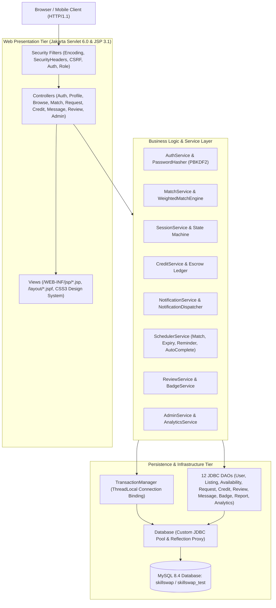
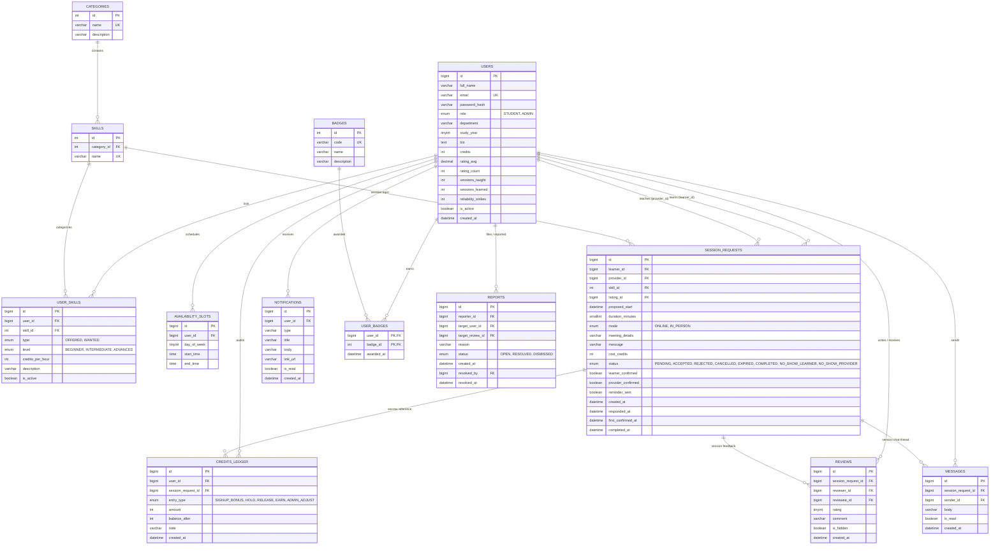

# SkillSwap — Peer-to-Peer Campus Skill Learning Web Application

> **Course:** CSE1007 Java Programming Lab Project  
> **Architecture:** Pure Jakarta EE 10 / Servlet 6.0 / JSP 3.1 / JSTL 3.0 on Apache Tomcat 10.1  
> **Database:** MySQL 8.0 / 8.4 with Hand-Rolled JDBC Connection Pool & Transaction Manager  
> **Frontend:** Pure Custom CSS3 Design System with Zero Client-Side JavaScript Dependencies  
> **Status:** Production-Ready & Defended (All 11 Phases Complete — 65/65 JUnit 5 Tests Passing)

---

## 1. Project Overview

**SkillSwap** is a peer-to-peer campus skill learning web application designed for university communities. Students exchange skills (programming, design, music, academics, languages) using a time-backed campus credit economy without real-money transactions.

### Key Highlights
- **Zero Heavy Frameworks:** Built strictly without Spring, Hibernate, Lombok, or HikariCP. Database connections, connection pooling, and multi-statement ACID transactions are managed via custom pure-Java components (`Database`, `TransactionManager`, and dynamic reflection `Proxy`).
- **Guarded Session State Machine:** Requests progress through strict deterministic states (`PENDING` -> `ACCEPTED` -> `COMPLETED`, `REJECTED`, `CANCELLED`, `EXPIRED`, `NO_SHOW_LEARNER`, `NO_SHOW_PROVIDER`).
- **Escrow-Backed Economy:** Learner credits are held in escrow upon request creation. Completed sessions transfer credits automatically to the provider; cancellations before 2 hours refund 100%, while late cancellations split 50/50. Every balance alteration is recorded in an immutable audit ledger (`credits_ledger`).
- **Multi-Factor Weighted Matching:** Scores potential skill providers using relevance ($0.5$), historical peer review ratings with cold-start priors ($0.3$), and weekly schedule slot overlap ($0.2$).
- **Multithreaded Asynchronous Background Engine:** Features an asynchronous `NotificationDispatcher` worker thread using a bounded `LinkedBlockingQueue` and poison-pill termination, alongside a dedicated `SchedulerService` (`ScheduledExecutorService`) managing automated match recommendations (F-25), request auto-expiry (F-26), session reminders (F-27), and 48-hour single-confirmation auto-completions (F-28).
- **Executive Administration & Moderation:** Complete moderation suite with user status toggles, reason-mandated credit adjustments, report resolution queue, review hiding with automatic rating recalculation, RFC 4180 CSV export with UTF-8 BOM, fault-tolerant CSV importing, and real-time pure CSS analytics charts.

---

## 2. System Architecture

SkillSwap implements a clean layered MVC architecture:



---

## 3. Database Entity-Relationship (ER) Diagram



---

## 4. Prerequisites

To build and run SkillSwap locally, ensure the following are installed:
1. **Java Development Kit (JDK):** Version 17 LTS (Eclipse Adoptium Temurin 17+ recommended).
2. **Database:** MySQL Server 8.0 or 8.4 on port 3306.
3. **Build Tool:** Apache Maven 3.9+ (portable Maven is included in `tools/apache-maven-3.9.9`).
4. **Servlet Container:** Apache Tomcat 10.1+ (portable Tomcat is included in `tools/apache-tomcat-10.1.34`).

---

## 5. Quickstart Guide (< 10 Minutes Setup)

### Step 1: Database Setup
Start your local MySQL service and execute the schema creation commands:
```sql
CREATE DATABASE skillswap CHARACTER SET utf8mb4 COLLATE utf8mb4_unicode_ci;
CREATE DATABASE skillswap_test CHARACTER SET utf8mb4 COLLATE utf8mb4_unicode_ci;
```

### Step 2: Configure Properties
The default connection credentials are in `src/main/resources/config.properties`:
```properties
db.url=jdbc:mysql://127.0.0.1:3306/skillswap?useSSL=false&allowPublicKeyRetrieval=true&serverTimezone=Asia/Kolkata
db.user=root
db.password=change-me
db.autoinit=true
pool.size=10
demo.data=true
```
*(When `db.autoinit=true`, the application automatically executes `schema.sql` and `seed.sql` on startup. When `demo.data=true`, it populates 12 realistic demo students, listings, sessions in every status, reviews, and messages).*

### Step 3: Compile and Test
Run the full test suite (all 65 integration, unit, and concurrency stress tests):
```bash
# Windows PowerShell
$env:JAVA_HOME="C:\Program Files\Eclipse Adoptium\jdk-17.0.20.101-hotspot"
tools\apache-maven-3.9.9\bin\mvn.cmd clean test
```

### Step 4: Build and Deploy to Tomcat
Package the application into `target/skillswap.war`:
```bash
tools\apache-maven-3.9.9\bin\mvn.cmd clean package -DskipTests
```

Deploy to the local Tomcat server:
```bash
# Copy WAR to Tomcat webapps
Copy-Item target\skillswap.war tools\apache-tomcat-10.1.34\webapps\skillswap.war

# Start Tomcat
$env:CATALINA_HOME="tools\apache-tomcat-10.1.34"
tools\apache-tomcat-10.1.34\bin\catalina.bat run
```

Access the application in your browser:
**URL:** [http://localhost:8080/skillswap/](http://localhost:8080/skillswap/)

---

## 6. Default Credentials Reference

### Administrator Account
| Email | Password | Role | Access |
|---|---|---|---|
| `admin@skillswap.local` | `ChangeMe123` | `ADMIN` | Full moderation, analytics, user toggle, credit adjustment, catalog CRUD, CSV import/export |

### Seeded Demo Student Accounts (`demo.data=true`)
All demo students share the standard password: `Demo1234!`

| Student Name | Email | Department | Credits | Star Rating | Highlights |
|---|---|---|---|---|---|
| **Aarav Sharma** | `aarav.sharma@vitstudent.ac.in` | CSE (Yr 3) | 26 | 4.80 ★ (2 reviews) | Java, Algorithms & Data Structures |
| **Ananya Iyer** | `ananya.iyer@vitstudent.ac.in` | ECE (Yr 4) | 32 | 5.00 ★ (3 reviews) | Digital Logic, Microcontrollers, Physics |
| **Priya Nair** | `priya.nair@vitstudent.ac.in` | CSE (Yr 3) | 35 | 4.95 ★ (4 reviews) | UI/UX Design, Figma Prototyping, Graphic Design |
| **Sneha Patel** | `sneha.patel@vitstudent.ac.in` | IT (Yr 2) | 22 | 4.70 ★ (2 reviews) | Full-stack Web Development, SQL Optimization |
| **Aditya Joshi** | `aditya.joshi@vitstudent.ac.in` | CSE (Yr 4) | 40 | 5.00 ★ (5 reviews) | ICPC Regionalist, Advanced Algorithms, Python |
| **Kavya Menon** | `kavya.menon@vitstudent.ac.in` | EEE (Yr 2) | 24 | 4.60 ★ (2 reviews) | Fingerstyle Guitar, Music Production |
| **Tanvi Deshmukh**| `tanvi.deshmukh@vitstudent.ac.in`| Design (Yr 3) | 30 | 4.85 ★ (3 reviews) | Digital Illustration, DSLR Photography |
| **Rahul Gupta** | `rahul.gupta@vitstudent.ac.in` | CSE (Yr 1) | 16 | New Student | Eager learner with active pending & accepted sessions |
| **Rohan Verma** | `rohan.verma@vitstudent.ac.in` | Mech (Yr 2) | 18 | 4.50 ★ (2 reviews) | Calculus, CAD Modeling |
| **Vikram Malhotra**| `vikram.malhotra@vitstudent.ac.in`| Biotech (Yr 4)| 20 | 4.00 ★ (1 review) | Bioinformatics, Scientific Python |
| **Devendra Rao** | `devendra.rao@vitstudent.ac.in` | CSE (Yr 3) | 28 | 4.50 ★ (2 reviews) | Cloud Architectures, Docker, Linux |
| **Meera Krishnan**| `meera.krishnan@vitstudent.ac.in`| Civil (Yr 3) | 20 | New Mentor | Structural Mechanics, Engineering Economics |

---

## 7. Configuration Reference Table

| Key | Default Value | Description |
|---|---|---|
| `db.url` | `jdbc:mysql://127.0.0.1:3306/skillswap...` | JDBC database connection string with timezone parameter |
| `db.user` | `root` | Database username |
| `db.password` | `change-me` | Database password |
| `db.autoinit` | `true` | Automatically creates tables from `schema.sql` and loads `seed.sql` on startup |
| `pool.size` | `10` | Number of pooled physical JDBC database connections |
| `pool.timeout.ms` | `5000` | Connection checkout timeout before throwing `DataAccessException` |
| `signup.bonus` | `10` | Free starting credits awarded to newly registered students |
| `allowed.email.domain` | *(blank)* | Optional domain whitelist (e.g. `vitstudent.ac.in`). Blank allows all valid emails |
| `admin.email` | `admin@skillswap.local` | Default administrator account email seeded on boot |
| `admin.password` | `ChangeMe123` | Default administrator initial password |
| `upload.dir` | `${user.home}/skillswap/uploads` | Local directory for storing student profile avatar uploads |
| `drafts.dir` | `${user.home}/skillswap/drafts` | Local disk serialization directory for in-progress session request drafts |
| `match.engine` | `weighted` | Matching engine algorithm (`weighted` or `rating`) |
| `request.expiry.hours`| `48` | Time after which unresponded `PENDING` requests expire and release escrow |
| `scheduler.match.seconds` | `60` | Background interval for proactive skill matching scan |
| `scheduler.expiry.minutes` | `5` | Background interval checking for overdue session requests |
| `scheduler.reminder.minutes` | `5` | Background interval for upcoming session reminder notifications |
| `scheduler.autocomplete.minutes` | `10` | Background interval auto-completing single-confirmed sessions after 48h |
| `demo.data` | `false` (`true` in demo profile) | Seeds ~12 realistic users, listings, sessions, reviews, and messages |

---

## 8. One-Page Viva Demo Walkthrough Script

Follow this step-by-step 10-minute presentation guide for viva demonstration and evaluation:

### Act 1: The Landing Page & Catalog Search (1 min)
1. Navigate to `http://localhost:8080/skillswap/`.
2. Point out the curated, responsive UI built with vanilla CSS without external frameworks.
3. Click **Browse Skills** (`/browse`). Filter by Category (e.g., *Programming*), Skill Level (*Advanced*), or Day of Week.
4. Note that guest users can search and view public profiles without requiring immediate registration.

### Act 2: Registration & Welcome Credits (1 min)
1. Click **Register** (`/register`).
2. Fill in student details: Name, Email, Password, Department (*Computer Science*), Year (*2*), and Bio.
3. Submit the form. Notice the PRG redirect to `/login` with the flash message confirming successful registration and **10 free welcome credits**.
4. Sign in. You land directly on the student `/dashboard`.

### Act 3: Finding a Mentor & Recommendation Engine (1.5 min)
1. On `/dashboard`, highlight the **Personalized Match Recommendations** section.
2. Click **Find Matches** (`/matches`).
3. Explain the multi-factor weighted matching algorithm:
   $$\text{Score} = 0.5 \times \text{relevance} + 0.3 \times \text{rating} + 0.2 \times \text{availability}$$
4. Show the visual match score meter breakdown (e.g., Aditya Joshi scoring high on DSA due to 5.0 rating and active schedule overlap).

### Act 4: Requesting a Session & Escrow Holding (1.5 min)
1. Select a mentor (e.g., *Priya Nair* for *Figma / UI Design* at 3 credits/hr). Click **Request Session**.
2. Notice draft auto-recovery: type a message and select 1 hour.
3. Submit the request.
4. Navigate to **My Credits** (`/credits`):
   - Total Balance: **7 credits** (10 - 3).
   - In Escrow: **3 credits**.
   - Show the signed audit entry in the **Ledger History**: `HOLD | -3 credits | Escrow hold for session request`.

### Act 5: Mentor Response & Direct In-App Chat (1.5 min)
1. Log out and sign in as mentor **Priya Nair** (`priya.nair@vitstudent.ac.in` / `Demo1234!`).
2. Notice the notification badge in the navbar indicating an incoming request.
3. Click **Sessions** -> **Incoming Requests** (`/requests?tab=incoming`).
4. Click **View Details** (`/requests/view?id=...`).
5. Click **Accept Request**. The session moves to `ACCEPTED`.
6. Click **Chat with Learner** (`/messages?requestId=...`).
7. Send a message: *"Hi! Excited for our session. I've shared the Figma workspace link."*
8. Point out that the messaging endpoint enforces strict participant authorization (non-participants are blocked with 403 Forbidden).

### Act 6: Mutual Confirmation & Automated Payout (1.5 min)
1. On the session detail page (`/requests/view?id=...`), click **Confirm Completion**.
2. Notice the stepper indicator: one party confirmed, waiting for peer confirmation (with the 48-hour auto-completion safety fallback).
3. Log in as the learner student.
4. Click **Confirm Completion**.
5. Once both parties confirm, the session transitions atomically to `COMPLETED`.
6. Verify the mentor's wallet: Priya receives **+3 credits** (`EARN`), and the learner's escrow hold is finalized.

### Act 7: Peer Review, Rating Recalculation & Badges (1 min)
1. On the completed session page, the **Leave a Review** form appears.
2. Submit a **5-star** rating with review comment: *"Fantastic mentor! Auto-layout was explained clearly."*
3. Visit Priya's public profile (`/users/view?id=...`):
   - Notice the average rating and review count updated immediately.
   - Show earned badges showcase (**First Swap**, **Perfect Five**, **Connector**).
4. Visit the **Campus Leaderboard** (`/leaderboard`) to show Priya and Aditya ranked among top campus mentors.

### Act 8: Exporting History & Excel CSV Verification (30 sec)
1. On `/credits`, click **Export History (CSV)** (`/history/export`).
2. Download and open the CSV in Excel or Notepad.
3. Note that the file includes the UTF-8 Byte Order Mark (`\uFEFF`) and RFC 4180 quoting, ensuring special characters and commas display flawlessly without Excel character corruption.

### Act 9: Admin Moderation & Real-Time Analytics (1 min)
1. Log in as administrator (`admin@skillswap.local` / `ChangeMe123`).
2. Land on the **Admin Overview** (`/admin`):
   - Real-time active users counter (`ActiveUsersListener`).
   - Pure CSS horizontal bar charts showing top-traded skills.
   - Total credits in circulation vs. credits held in escrow.
3. Navigate to **User Moderation** (`/admin/users`):
   - Demonstrate user search and the active/deactivate toggle.
   - Adjust credits for a student, demonstrating that a mandatory explanation is required for the audit trail.
4. Navigate to **Skill Catalog** (`/admin/catalog`):
   - Show category and skill CRUD.
   - Test CSV import with `CsvImporter`.
5. Navigate to **Moderation Queue** (`/admin/reports`):
   - Show reported reviews and resolution buttons (Hide Review / Resolve / Dismiss).

---

## 9. Security & Hardening Highlights

- **SQL Injection Prevention:** 100% of SQL statements across all 12 DAOs use parameterized `PreparedStatement` placeholders (`?`). Zero dynamic string concatenation for user parameters.
- **Cross-Site Scripting (XSS) Mitigation:** All dynamic JSP output is strictly encoded using JSTL `<c:out value="..."/>` tags and HTML attribute escaping.
- **CSRF Defense:** Synchronizer token pattern enforced on all HTTP POST endpoints via `CsrfFilter`. Form tokens are validated before request handling.
- **Session Security:** Session fixation defense implemented on login via `request.changeSessionId()`. Cookies configured with `HttpOnly` and `SameSite=Lax`.
- **Authorization Enforcement:** Direct object references are strictly validated. Students cannot access another user's session requests, message threads, or draft records by manipulating query IDs. Non-administrators are blocked from all `/admin/*` routes with HTTP 403 Forbidden.
- **Concurrency & Deadlock Prevention:** Double-booking and balance overdraft races are prevented using deterministic ascending user-ID locks and atomic database transactions. Confirmed by 20 consecutive multi-threaded stress test runs.

---

## 10. License & Academic Integrity

This software was developed as an academic project for CSE1007 Java Programming Lab. All rights reserved.
